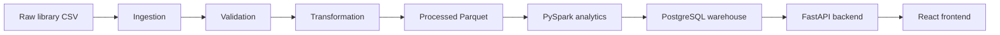

# LibraSight

## Executive summary

LibraSight is a library analytics and data engineering project designed to process raw circulation data into actionable operational insights. The repository implements a local ETL pipeline that ingests transaction-level library records, validates the quality of the source dataset, removes invalid rows, standardizes the cleaned dataset, computes analytics with PySpark, stores results in a warehouse-oriented schema, exposes the information through a FastAPI backend, and presents dashboards through a React frontend.

The project is intended to support operational reporting for library management and decision-making. Its core value is the transformation of raw circulation data into structured, queryable, and visual business intelligence. The current repository demonstrates a working local analytics pipeline with validated ETL logic, dashboard-ready metrics, and an API layer for downstream reporting use.

## Project identification

- Project name: LibraSight
- Domain: library operations analytics
- Primary data domain: circulation, membership, book usage, branch activity, and library quality monitoring
- Primary technology stack: Python, pandas, PySpark, PostgreSQL, FastAPI, React, Airflow, Docker
- Deployment style: local prototype / analytical workflow demonstration

## Business objective

The purpose of the project is to provide a practical library analytics environment that can answer operational questions related to:
- circulation trends over time
- reader engagement and behavior
- branch and city-level performance
- collection-level and title-level usage
- fines, renewals, and reservation activity
- source-data quality and invalid-record monitoring

## Report-ready project overview

LibraSight combines data engineering and business intelligence in a single repository. It reads a raw library dataset, validates the incoming records against expected business and structural rules, cleans and normalizes the data, stores the result in a structure designed for analytics, and serves the final results through an API and visual dashboard.

The repository is best described as a local, end-to-end data analytics prototype for library operations reporting. It is organized as a multi-layer pipeline and is suitable for continued enhancement, local demonstrations, and analytical reporting workflows.

## 1. Project overview

This project is designed to help library operations teams analyze:
- circulation trends
- reader usage and demographic patterns
- branch performance
- collection and title distribution
- transaction and fine patterns
- data quality problems in incoming source files

The repository combines several layers into one workflow:
- raw data ingestion
- structural and business-rule validation
- cleaning and transformation
- analytical processing with PySpark
- warehouse loading
- API access
- dashboard visualization
- reporting and export artifacts

## 2. Scope and business context

The project is centered on transaction-level library data. The main source data is a raw CSV dataset containing records such as:
- transaction identifiers
- reader information
- book metadata
- branch metadata
- checkout, due, and return dates
- transaction status and renewal/reservation metrics
- fine amounts and availability counts

The intended outcome is a reusable local analytics solution that can answer questions such as:
- which books, authors, and genres drive circulation?
- which branches perform best?
- which reader segments are most active?
- how often are due dates, fines, or reservations involved?
- what proportion of source records fail validation?

## 3. High-level architecture

The repository follows a standard analytics pipeline:

1. Raw CSV ingestion
2. Validation and rejection handling
3. Cleaning and standardization
4. Parquet output creation
5. PySpark analytical processing
6. PostgreSQL warehouse loading
7. API-driven consumption
8. Frontend dashboard presentation



## 4. Data flow

The actual project flow is implemented through the following repository components:

### 4.1 Raw source data
- Source file: `data/raw/library_raw_data.csv`
- This is the original library transaction dataset used as the upstream input.

### 4.2 Ingestion stage
- Module: `ingestion/ingest.py`
- Helper module: `ingestion/readers.py`
- Purpose:
  - reads source CSV data
  - validates basic file/path availability
  - checks required columns
  - prepares the DataFrame for validation and downstream processing

The ingestion stage uses path resolution through the repository root and supports reading the raw file expected by the pipeline.

### 4.3 Validation stage
- Module: `validation/validate.py`
- Purpose:
  - checks structural integrity
  - validates numeric fields
  - validates dates
  - checks missing values and duplicate rows
  - identifies logically invalid records
  - writes data-quality output files

Validation writes output files into `data/quality/`:
- `data_quality_report.csv`
- `rejected_records.csv`

The validation logic checks expected columns and verifies the data matches the pipeline schema. It also tracks duplicate records and empty rows.

### 4.4 Transformation stage
- Module: `transformation/clean_transform.py`
- Purpose:
  - loads raw data and rejected IDs
  - removes invalid and duplicate records
  - normalizes data types
  - standardizes values
  - cleans dates and fields
  - writes the cleaned dataset as Parquet

The output is stored at:
- `data/processed/library_clean.parquet`

This cleaned Parquet file is the canonical dataset used by the analytics and warehouse loading stages.

### 4.5 PySpark analytics stage
- Module: `spark/jobs/library_spark_job.py`
- Purpose:
  - reads the cleaned Parquet file
  - builds aggregate analytics
  - computes key operational metrics
  - writes output files under `spark/output/`

The analytics script computes summaries for:
- books
- genres
- readers
- branches
- collection trends
- time-based patterns such as monthly and yearly behavior
- status and fine summaries

### 4.6 Warehouse loading stage
- Modules: `database/schema.sql`, `database/load_data.py`, `database/queries.sql`
- Purpose:
  - structure the data warehouse
  - create dimensions and fact tables
  - load fact transaction data into a star schema

The project is designed around a star schema with dimensions covering:
- date
- reader
- book
- branch

The central fact table is:
- `fact_library_transaction`

## 5. Repository structure

Top-level folders and their purpose:

- `airflow/` — Airflow DAG and runtime files for pipeline orchestration
- `backend/` — FastAPI application and router logic
- `data/` — raw, processed, and quality datasets
- `database/` — SQL schema and loading scripts
- `docs/` — project architecture and data-flow documentation
- `frontend/` — Vite + React frontend app
- `ingestion/` — input readers and ingestion logic
- `powerbi/` — Power BI related artifacts
- `reports/` — generated reporting outputs
- `spark/` — Spark processing jobs and output artifacts
- `tests/` — project-level automated tests
- `transformation/` — ETL cleaning and standardization logic
- `validation/` — validation and quality checks
- `tools/` — utilities for reports and inspection

## 6. Core project files

### Data pipeline files
- `ingestion/readers.py` — file loading and source-data helper logic
- `ingestion/ingest.py` — raw CSV import and schema validation
- `validation/validate.py` — validation checks and quality report generation
- `transformation/clean_transform.py` — normalized and cleaned output generation
- `spark/jobs/library_spark_job.py` — aggregation and analytics creation
- `database/load_data.py` — warehouse load process
- `database/schema.sql` — database schema definitions

### Application and UI files
- `backend/app/main.py` — FastAPI application entry point
- `backend/app/database.py` — database session access
- `backend/app/routers/dashboard.py` — dashboard summary and analytics endpoints
- `backend/app/routers/books.py` — book-related analytics/queries
- `backend/app/routers/readers.py` — reader-related analytics/queries
- `backend/app/routers/branches.py` — branch-related analytics/queries
- `backend/app/routers/collection.py` — collection metrics
- `backend/app/routers/reports.py` — reporting endpoints
- `backend/app/routers/data_quality.py` — quality-monitoring endpoints
- `backend/app/routers/notifications.py` — notifications-related endpoints
- `frontend/src/` — React dashboard components, charts, pages, and services
- `frontend/package.json` — frontend dependencies and scripts

### Orchestration and runtime files
- `airflow/dags/library_etl_dag.py` — ETL workflow DAG
- `docker-compose.yml` — local orchestration container setup
- `Dockerfile` — container image definition

## 7. Data model and warehouse design

The data pipeline is centered on a transaction-driven dataset. The validation and transformation logic assumes the following core fields are present:

- `transaction_id`
- `reader_id`
- `reader_name`
- `age`
- `gender`
- `reader_type`
- `membership_date`
- `home_branch_id`
- `book_id`
- `isbn`
- `book_title`
- `author`
- `genre`
- `publication_year`
- `language`
- `format`
- `publisher`
- `branch_id`
- `branch_name`
- `city`
- `area`
- `library_type`
- `branch_capacity`
- `checkout_date`
- `due_date`
- `return_date`
- `transaction_status`
- `renewal_count`
- `reservation_flag`
- `reservation_count`
- `checkout_method`
- `fine_amount`
- `total_copies`
- `available_copies`
- `collection_status`

The schema includes a star-schema style structure with dimension tables such as:
- `dim_date`
- `dim_reader`
- `dim_book`
- `dim_branch`

The fact table is:
- `fact_library_transaction`

The fact table stores transactional details such as:
- transaction ID
- reader and book keys
- branch and date keys
- checkout, due, and return dates
- transaction status
- renewal and reservation counts
- checkout method
- fine amount
- copies and availability counts

## 8. Validation rules implemented in the project

The validation engine in `validation/validate.py` performs multiple checks.

### 8.1 Structural validation
- required column count
- missing expected columns
- duplicate records
- completely empty rows

### 8.2 Type validation
- numeric checks for:
  - `age`
  - `publication_year`
  - `branch_capacity`
  - `renewal_count`
  - `reservation_count`
  - `fine_amount`
  - `total_copies`
  - `available_copies`

### 8.3 Date validation
The pipeline validates date values for:
- `membership_date`
- `checkout_date`
- `due_date`
- `return_date`

The parser accepts common formats such as:
- `YYYY-MM-DD`
- `DD/MM/YYYY`
- `DD-MM-YYYY`
- `DD-MMM-YYYY`

### 8.4 Logical and business-rule validation
The repository includes checks for conditions such as:
- negative or invalid numeric values
- negative available copies
- duplicate transaction IDs
- age values outside expected ranges
- invalid publication year values
- negative fine amounts
- due or return dates earlier than checkout date
- data rows that violate expected business logic

These invalid records are recorded and then removed during the transformation stage.

## 9. Transformation logic

The cleaning logic in `transformation/clean_transform.py` performs these actions:
- loads raw source data
- loads rejected records
- removes invalid rows by transaction ID
- removes exact duplicate rows
- removes duplicate transaction IDs, preserving the first occurrence
- standardizes date values
- converts and cleans numeric values
- normalizes text values when needed
- writes the final cleaned dataset to Parquet

The output file is:
- `data/processed/library_clean.parquet`

## 10. PySpark analytics included in the project

The Spark job produces analytical summaries for:
- books and authors
- genres
- reader types
- branches and cities
- collection-level metrics
- monthly and yearly trends
- status distribution
- fine totals

The analytics pipeline reads the cleaned Parquet file and computes metrics using Spark DataFrame operations, including grouping and aggregation functions such as:
- `count`
- `sum`
- `avg`
- `year`
- `month`

The outputs are written to `spark/output/`.

## 11. API and dashboard layers

The FastAPI application is created in `backend/app/main.py` and includes routers for:
- dashboard
- books
- readers
- branches
- reports
- collection
- data quality
- notifications

The app exposes a root endpoint and a health check endpoint:
- `/`
- `/health`

The dashboard router includes query filters for:
- `year`
- `branch_id`
- `genre`
- `start_date`
- `end_date`

These filters drive summary and trend queries in the warehouse tables.

## 12. Frontend application

The frontend module is a React + Vite project located under `frontend/`.

Relevant frontend stack:
- React
- Vite
- Recharts
- Axios
- React Router
- Lucide icons

Frontend directories:
- `frontend/src/pages/` — page-level views
- `frontend/src/components/` — reusable UI components
- `frontend/src/charts/` — chart implementations
- `frontend/src/services/` — API interaction logic

The frontend connects to the backend API running locally on port 4173/8000 based on the dev setup.

## 13. Local setup and run commands

### 13.1 Python environment
```bash
python -m venv .venv
.venv\Scripts\Activate.ps1
pip install -r requirements.txt
```

### 13.2 Backend API
```bash
cd backend
python -m uvicorn app.main:app --host 0.0.0.0 --port 8000 --reload
```

Endpoints:
- http://localhost:8000
- http://localhost:8000/docs

### 13.3 Frontend app
```bash
cd frontend
npm install
npm run dev -- --host 0.0.0.0 --port 4173
```

Frontend URL:
- http://localhost:4173

### 13.4 Airflow orchestration
```bash
docker-compose up --build
```

Airflow UI:
- http://localhost:8080

## 14. Manual pipeline execution

The repository can also be executed step-by-step from the project root:

```bash
python ingestion/ingest.py
python validation/validate.py
python transformation/clean_transform.py
python spark/jobs/library_spark_job.py
python database/load_data.py
```

Expected output locations:
- `data/raw/`
- `data/processed/`
- `data/quality/`
- `spark/output/`

## 15. Generated outputs and artifacts

The project produces and relies on the following artifacts:

- `data/raw/library_raw_data.csv` — source dataset
- `data/quality/data_quality_report.csv` — quality summary report
- `data/quality/rejected_records.csv` — rejected invalid rows
- `data/processed/library_clean.parquet` — cleaned canonical dataset
- `spark/output/` — aggregated analytical parquet output folders
- `reports/generated/` — generated reports
- `backend/app/routers/reports.py` — report-generating endpoints
- `powerbi/` — Power BI-related project artifact
- `airflow/logs/` — Airflow execution logs

## 16. Automated testing

The project includes automated tests across the core ETL and API layers. Test files include:
- `tests/test_api.py`
- `tests/test_db_load.py`
- `tests/test_ingestion.py`
- `tests/test_pdf_reports.py`
- `tests/test_readers.py`
- `tests/test_spark_output.py`
- `tests/test_transformation.py`
- `tests/test_validation.py`

Run the project tests with:

```bash
pytest
```

Verified local command:

```bash
cd 'd:\LibraSight'; .\.venv\Scripts\python.exe -m pytest -q tests/test_ingestion.py tests/test_validation.py tests/test_transformation.py
```

Result as observed in the current environment:
- 40 passed
- 0 failed

## 17. Detailed project features and report-ready capabilities

LibraSight is designed not only as a data pipeline, but as a complete operational analytics solution for library management. Its core features are aligned with real-world library reporting needs and support managerial decision-making across operational, branch, and collection-level analysis.

### 17.1 Data ingestion and source management
- reads source circulation data from a raw CSV file
- validates file existence, required columns, and input structure
- handles duplicate and malformed rows before data is transformed
- prepares the dataset for downstream warehouse and analytical processing

### 17.2 Data quality and validation engine
- verifies missing, duplicate, or empty records
- checks numeric integrity for age, year, copies, fine amounts, and branch metrics
- validates dates in multiple common formats
- detects logical inconsistencies such as return dates before checkout dates or negative values
- stores rejected results and quality summaries for monitoring and reporting

### 17.3 Data cleaning and standardization
- removes invalid records after validation
- deduplicates transaction records by transaction ID
- normalizes field values and date formats
- writes a canonical cleaned dataset for analytics and warehouse loading
- supports consistent downstream reporting by ensuring data quality before compute layers run

### 17.4 Analytical processing with PySpark
- computes summary metrics across books, readers, branches, cities, genres, and collections
- calculates monthly and yearly trends using time-based grouping
- aggregates circulation, fine, reservation, and availability metrics
- supports reporting across multiple dimensions without requiring a separate BI tool for basic analysis

### 17.5 Star-schema warehouse model
- structures data around a library transaction fact table
- creates supporting dimension tables for date, reader, book, and branch
- enables aggregation-heavy queries for operational dashboards and reporting
- supports efficient drill-down analysis for branch and collection performance

### 17.6 API layer for operational dashboards
- provides FastAPI endpoints for summary analytics, dashboard filters, and report generation
- allows data to be queried by year, branch, genre, and date range
- exposes standardized backend access for web and reporting clients
- supports health checks and integration with frontend views

### 17.7 Frontend dashboard experience
- React + Vite dashboard with multiple pages for key operational views
- pages include dashboard overview, books, readers, branches, collection health, data quality, reading trends, and reports
- interactive visual analytics and summaries for non-technical stakeholders
- business-friendly navigation for operational overview and monitoring

### 17.8 Reporting and export capability
- generates summary and analytical reports through backend routes
- produces quality and trend outputs for operational review
- supports Power BI and PDF-style reporting artifacts alongside API-based analytics
- makes the project suitable for internal library analytics demonstrations and managerial reporting workflows

## 18. Business value and KPI coverage

The project is designed to help library administrators and operations teams answer business questions such as:
- Which books, genres, and authors are driving circulation demand?
- Which branches or cities are performing best by transaction volume and fines?
- How do reader segments behave over time?
- Are collection availability and library inventory levels healthy?
- What proportion of source data fails validation and requires intervention?
- Which months or years show the strongest operational activity?

Key decision-support metrics supported by the project include:
- transaction counts
- reader and branch counts
- transaction status distribution
- monthly and yearly trends
- fine totals and reservation activity
- collection availability and stock status
- data quality monitoring and rejected-record analysis

## 19. API and dashboard feature map

The repository exposes a practical analytics surface through the backend and user dashboard:

### API modules
- `/dashboard/summary` — summary metrics for total transactions, books, readers, and branches
- `/dashboard/trends` — monthly transaction trend information
- `/dashboard/status` — status distribution of transactions
- `/dashboard/analytics` — expanded dashboard analytics across methods, fines, genres, branches, and inventory health
- `/books/*` — books-related analytics and reporting views
- `/readers/*` — reader activity and engagement metrics
- `/branches/*` — branch comparisons and performance summaries
- `/collection/*` — collection and stock health metrics
- `/data-quality/*` — quality-check summaries and rejected-record outputs
- `/reports/*` — operational reporting endpoints
- `/notifications/*` — operational notifications and monitoring data

### Frontend pages
- Dashboard overview
- Books analysis
- Readers analysis
- Branches analysis
- Reading trends
- Collection performance
- Data quality monitoring
- Reports

## 20. Current project status

The repository is a functioning local analytics prototype. The core ETL flow is validated and working in the current environment, including:
- ingestion
- validation
- transformation
- analytics generation
- API serving
- frontend access

The project is best understood as a local data workflow demonstration and prototype that is structured for continued development.

## 21. Operational caveats

Important project realities observed from the repository and runtime behavior:
- the project contains an Airflow orchestration layer and Docker setup, but the runtime environment is sensitive to import-path and packaging issues
- the core ETL logic is validated independently and works in the current local environment
- the project is not framed as a production cloud-native deployment; it is a local prototype with analytics and warehouse-building capabilities
- significant orchestration stability should be checked if the project is moved into a new runtime or deployment target

## 22. Summary

LibraSight is a library analytics pipeline built to process raw circulation records into a usable business intelligence system. It brings together data validation, transformation, warehouse modeling, PySpark analytics, FastAPI APIs, and React dashboards in a single repository, with strong emphasis on local execution and analytic reporting. The repository currently demonstrates a working ETL and analytics cycle for library operations reporting, with the main attention area being environment/runtime stability for orchestration and deployment scenarios.

## Tech Stack

- Python
- Pandas
- PySpark
- PostgreSQL
- FastAPI
- React
- Vite
- Airflow
- Docker
- SQL
- ETL / data pipeline processing