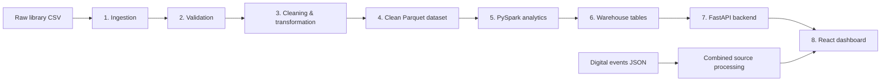

# LibraSight

LibraSight is a library operations analytics platform that turns raw library data into clean, useful business insight. It combines ingestion, validation, transformation, data warehousing, a FastAPI backend, and a React dashboard into one end-to-end analytics system for library operations teams.

The project is designed to answer questions such as:
- Which books, subjects, and genres are most in demand?
- Which branches are performing best?
- Which reader segments are most active?
- How are fines, reservations, and checkouts changing over time?
- What percentage of incoming records are clean versus rejected?

The repository is structured as a local, end-to-end data engineering and reporting solution that can be run on a laptop or development machine without requiring a large production deployment setup.

## Tech stack

### Data engineering and analytics
- Python
- pandas
- PySpark
- NumPy
- PyArrow
- SQLAlchemy
- PostgreSQL-style warehouse modeling
- Airflow for orchestration support

### API and backend
- FastAPI
- Uvicorn
- Pydantic
- Python dotenv
- SQLAlchemy ORM

### Frontend
- React
- Vite
- React Router
- Recharts
- Axios
- Lucide React

### Reporting and utilities
- ReportLab for PDF generation
- Matplotlib
- pypdf
- pytest for automated validation

### Infrastructure and local setup
- Docker / Docker Compose
- Local filesystem-based data pipeline
- PostgreSQL-compatible warehouse schema and SQL scripts

## Business purpose of the system

LibraSight is not just a data upload project. It is a working library intelligence platform that helps operational teams understand how library resources are used across books, readers, branches, time periods, and collection health.

The system focuses on these business areas:
- circulation analysis
- reader engagement trends
- branch performance comparisons
- collection and availability monitoring
- reservation and hold demand
- data quality tracking and rejected records
- PDF reporting for library operations and executives

## Data sources used

LibraSight uses two main data sources, with the primary one being the raw library transaction dataset.

### 1. Primary transactional source
File: `data/raw/library_raw_data.csv`

This is the main dataset used by the ETL pipeline. It contains transaction-level library data such as:
- transaction_id
- reader_id, reader_name, reader_type, age, gender
- book_id, book_title, author, genre, publisher, publication_year
- branch_id, branch_name, city, area, library_type
- membership_date, checkout_date, due_date, return_date
- transaction_status, renewal_count, reservation_count
- checkout_method, fine_amount, total_copies, available_copies
- collection_status and related operational fields

This is the core dataset from which the dashboard metrics are generated.

### 2. Digital events / JSON source
File: `data/raw/library_digital_events.json`

This file is used as an additional source for combined analytics. It represents digital or system-level events and helps enrich the dashboard with operational events such as:
- catalog views
- e-book reads
- audiobook listens
- reservation requests
- renewal actions
- review submissions
- self-service and web portal activity
- event metadata such as source system, environment, event type, and timestamps

The JSON data is not treated as a replacement for the warehouse pipeline. Instead, it is normalized and merged into dashboard-friendly analytics so the UI can show both traditional library transactions and digital engagement patterns.

### 3. Generated system outputs
These are not source inputs but outputs created by the pipeline:
- `data/quality/data_quality_report.csv`
- `data/quality/rejected_records.csv`
- `data/processed/library_clean.parquet`
- `spark/output/` aggregated analytical results
- `reports/generated/` generated PDF reports

## How the pipeline flow works

The system follows a standard analytics pipeline from raw data to user-facing dashboard insight.



### Data movement through the project

1. Raw library data is read from the source CSV file.
2. The ingestion layer checks that files exist and required columns are present.
3. Validation verifies data structure, types, missing values, duplicates, date formats, and business rules.
4. Invalid rows are separated into a rejection list and logged into a quality report.
5. The remaining valid rows are normalized and transformed into a clean canonical dataset.
6. That data is written as a Parquet file and used by PySpark for aggregation.
7. The output is organized into warehouse-like tables for query and reporting.
8. The FastAPI backend queries these warehouse tables and serves analytics to the frontend.
9. The dashboard consumes the API responses and renders the charts, tables, and KPI cards.

## What happens in each layer

### 1. Ingestion layer
Location: `ingestion/ingest.py`, `ingestion/readers.py`

This layer is responsible for loading the raw source files into Python and preparing them for processing.

What it does:
- locates the raw input file
- supports environment-based override through `RAW_DATA_FILE`
- checks if CSV/JSON files exist
- reads the CSV or JSON structure into pandas DataFrames
- normalizes JSON payloads and handles common wrapper formats
- prepares the data for validation and transformation

Important role:
- It creates the starting point of the pipeline and ensures the source file is always accessible and structured enough to proceed.

### 2. Validation layer
Location: `validation/validate.py`

This layer ensures the source data is structurally and logically valid before it enters the clean analytics stage.

Validation checks include:
- required column presence
- duplicate rows
- empty rows
- null or missing values
- numeric validation for age, years, copies, fine values, counts
- date validation across formats like YYYY-MM-DD, DD/MM/YYYY, DD-MM-YYYY
- logical consistency checks like due dates before checkout dates
- negative or impossible values
- transaction IDs that are duplicated or invalid

Results:
- quality summary file created in `data/quality/data_quality_report.csv`
- rejected records written to `data/quality/rejected_records.csv`

This validation step is critical because it prevents bad records from corrupting the cleaned analytics dataset.

### 3. Transformation and cleaning layer
Location: `transformation/clean_transform.py`

This is where invalid or unusable records are removed and the data is made consistent.

What it does:
- loads raw data and rejected IDs
- removes invalid rows by transaction ID
- drops exact duplicates and duplicate transaction IDs
- trims whitespace and standardizes text values
- normalizes date values
- converts numeric fields to consistent types
- creates a canonical cleaned dataset
- writes final output to `data/processed/library_clean.parquet`

This cleaned dataset is the main source for downstream analytics and warehouse processing.

### 4. Analytics / PySpark layer
Location: `spark/jobs/library_spark_job.py`

This layer aggregates the cleaned data into operational metrics.

The analytics job computes:
- total transactions by time period
- books and authors with circulation totals
- genre popularity and category performance
- branch and city activity
- reader segment activity
- reservation and hold demand
- fine totals and penalty patterns
- collection stock and availability stats
- monthly and yearly trends

The outputs are written under `spark/output/` and used later by the backend queries.

### 5. Warehouse / database layer
Location: `database/schema.sql`, `database/load_data.py`, `database/queries.sql`

The project uses warehouse-style logic built around dimensions and fact tables.

Typical warehouse design:
- `dim_date`
- `dim_reader`
- `dim_book`
- `dim_branch`
- `fact_library_transaction`

This structure supports efficient operational reporting and makes the dashboard faster and easier to query for branch, month, book, and reader-level insights.

### 6. Backend API layer
Location: `backend/app/main.py`, `backend/app/routers/`

The FastAPI backend exposes endpoints for:
- summary KPI data
- trends and monthly cycles
- status groupings
- analytic drill-down data
- branch and reader statistics
- collection health analysis
- data quality overview
- PDF report generation
- notification-style operational summaries

The dashboard does not directly read the file system. Instead, it calls these API endpoints through Axios, which allows a consistent data contract between the frontend and backend.

### 7. Frontend dashboard
Location: `frontend/src/`

The frontend is a React + Vite application built for dashboard-based operational analysis. It includes pages for:
- dashboard overview
- books analysis
- readers analysis
- branch analysis
- data quality
- reports
- pipeline overview

The dashboard is designed to be easy for library staff to interpret while still being data-rich and filterable.

## What the dashboard does

The dashboard is the main operational interface of the project. It helps non-technical users explore patterns in the library data without opening the raw CSV or SQL tables.

### Dashboard flow

1. User opens the dashboard page.
2. FilterPanel allows filtering by year, branch, genre, and date range.
3. API requests are sent to backend routes like `/dashboard/summary`, `/dashboard/trends`, `/dashboard/status`, and `/dashboard/analytics`.
4. Backend SQL queries compute the filtered results against the warehouse data.
5. The frontend receives JSON payloads and renders KPI cards and charts.
6. If no results match the filter, the UI shows an empty state rather than breaking.

### Dashboard filters

The main filters available in the dashboard include:
- year
- branch_id
- genre
- start_date
- end_date

These filters allow the user to isolate a subset of data and answer targeted operational questions like:
- How did activity look in 2025 for Branch A?
- Which genres grew during Q2?
- What happened in the last 90 days across all branches?

## In-depth explanation of each dashboard chart and metric

The dashboard uses a mix of KPI cards and visual charts to show operational performance.

### 1. KPI cards
The first row shows four core metrics:
- Total Transactions
- Cataloged Books
- Active Readers
- Branches Active

These measure the overall health and activity of the selected time window. The dashboard always shows the filtered scope, so the KPIs update immediately whenever the user changes filters.

### 2. Monthly Circulation Volume
Chart type: area chart

This shows how transaction volume changes over time by month and year. It is useful for spotting:
- seasonal patterns
- rising or falling activity across the year
- monthly peaks and troughs
- whether one period is unusually strong or weak

### 3. Annual Circulation Comparison
Chart type: bar chart

This compares the number of transactions across years. It provides a quick year-over-year view of circulation activity and helps answer questions like:
- Are we getting more traffic each year?
- Did a particular year see a sudden drop or spike?

### 4. Operational Status Distribution
Chart type: donut / pie chart

This shows the distribution of transaction states such as active, returned, renewal request, reservation request, overdue, wishlist add, and other operational states. It helps library staff understand:
- the balance of user actions
- how often transactions are complete vs. pending
- where operational friction exists (for example overdue or reservation activity)

### 5. Genre Demand Overview
Chart type: horizontal bar chart

This is a ranking of the most active genres by circulation count. It helps identify which categories attract the most interest, for example:
- fiction vs. non-fiction
- technology, business, or history titles
- category-level interest among readers

It also provides summary stats such as top genre, average volume per genre, and total circulations.

### 6. Branch Performance Overview
Chart type: radar chart

This chart compares the output of branches across the filtered dataset. Each branch becomes a point on the radar, giving a view of relative circulation volume. It supports quick comparison of operational intensity across locations.

### 7. Member Engagement by Segment
Chart type: bar chart

This chart groups library activity by reader type, such as student, adult, senior, researcher, or unknown categories. It shows which segments are most active and helps identify the library users that contribute the most circulation volume.

### 8. Top Borrowed Titles
Table view

This table shows the most frequently borrowed books, including:
- title
- author
- genre
- circulation count

It helps identify the most popular titles and the content that is driving demand across the library network.

### 9. Checkout Channel Mix
Chart type: pie chart + list summary

This chart shows the share of transactions by access method, such as:
- Counter
- Self-Service
- Mobile App
- Online
- Other digital or kiosk methods

This is important because it highlights how users are interacting with the library system and which service channels are most used.

### 10. Reservation Demand & Hold Rate
Chart type: combined area + line chart

This chart tracks both:
- reservation demand (number of reservation requests)
- hold rate (% of transactions that involve holds or reservations)

It is useful for understanding how many users are waiting for titles and how often reservations are converting into actual demand.

### 11. Monthly Fine Accrual Trend
Chart type: bar chart

This shows the total fines assessed over time in INR. It helps identify:
- periods with heavy overdue activity
- patterns in penalties and compliance
- whether certain months show higher financial impact from late returns

### 12. Collection Health & Inventory Availability
Summary cards / operational metrics

This section presents:
- total copies
- available copies
- unavailable copies
- zero stock records

It shows whether the collection is healthy and whether titles are frequently unavailable when users try to access them.

## Dashboard data logic in detail

The dashboard is powered by a combined analytics flow:

- `getDashboardSummary()` calls `/dashboard/summary`
- `getDashboardTrends()` calls `/dashboard/trends`
- `getDashboardStatus()` calls `/dashboard/status`
- `getDashboardAnalytics()` calls `/dashboard/analytics`
- `getDashboardCombinedAnalytics()` calls `/dashboard/combined-analytics`

The frontend merges the standard warehouse response with the combined CSV + JSON analytics payload when available. This means the dashboard can show a richer and more current summary without replacing the original ETL pipeline.

The logic is intentionally layered:
- original warehouse analytics remain the primary system of record
- combined source analytics enrich the presentation layer
- the frontend still uses familiar filters and chart structures

## Reports feature

The Reports page provides downloadable PDF reports generated live from the project data. These reports are created on demand via the backend and delivered to the browser.

### Available reports

1. Monthly Library Performance
   - overall circulation and branch productivity
   - monthly transaction trends
   - reader behavior
   - book activity summary

2. Reading Trends Report
   - circulation patterns over time
   - genre popularity analysis
   - seasonal reading behavior

3. Collection Analysis Report
   - most borrowed titles
   - low-availability items
   - collection health overview
   - reservation and stock risk insight

4. Branch Performance Report
   - per-branch performance metrics
   - fine totals and service demand
   - comparison of library sites

5. Data Quality Audit Report
   - structural validation results
   - missing-value and duplicate checks
   - logical integrity problems
   - rejected records summary

### Report generation flow

- user clicks a report card on the Reports page
- the frontend calls a route such as `/reports/monthly-performance`
- the FastAPI backend executes the PDF generator
- the generator queries the relevant data and renders a PDF
- the browser downloads the generated file automatically

This makes reporting a true operational layer on top of the data pipeline rather than a static export.

## Repository structure

- `airflow/` — Airflow DAG and orchestration support
- `backend/` — FastAPI application and API logic
- `data/` — raw inputs, processed outputs, and quality artifacts
- `database/` — SQL schema and loading scripts
- `docs/` — architecture and documentation
- `frontend/` — Vite + React frontend
- `ingestion/` — source loading and normalization
- `powerbi/` — Power BI artifacts and related files
- `reports/` — generated report outputs
- `spark/` — Spark analytics job and output folders
- `tests/` — project tests for ETL and API behavior
- `transformation/` — cleaning and transformation logic
- `validation/` — validation and data quality checks
- `tools/` — inspection and report utility scripts

## Key project files

- `backend/app/main.py` — FastAPI app entry point
- `backend/app/routers/dashboard.py` — all dashboard analytics routes
- `backend/app/routers/reports.py` — PDF report endpoints
- `ingestion/readers.py` — CSV and JSON loading helper
- `validation/validate.py` — validation and rejection logic
- `transformation/clean_transform.py` — cleaning and canonical output generation
- `spark/jobs/library_spark_job.py` — analytics aggregation job
- `database/schema.sql` — warehouse schema definition
- `frontend/src/pages/Dashboard.jsx` — main dashboard layout and charts
- `frontend/src/pages/Reports.jsx` — reporting interface
- `frontend/src/services/api.js` — frontend API clients

## Local setup and run commands

### Python environment
```bash
python -m venv .venv
.venv\Scripts\Activate.ps1
pip install -r requirements.txt
```

### Start backend
```bash
cd backend
python -m uvicorn app.main:app --host 0.0.0.0 --port 8000 --reload
```

### Start frontend
```bash
cd frontend
npm install
npm run dev -- --host 0.0.0.0 --port 4173
```

### Optional orchestration
```bash
docker-compose up --build
```

### Manual ETL execution
```bash
python ingestion/ingest.py
python validation/validate.py
python transformation/clean_transform.py
python spark/jobs/library_spark_job.py
python database/load_data.py
```

## Test commands

```bash
pytest
```

Focused validation used during project verification:
```bash
cd "d:\LibraSight" && .\.venv\Scripts\python.exe -m pytest -q tests/test_ingestion.py tests/test_validation.py tests/test_transformation.py
```

## Summary

LibraSight is a complete local library analytics ecosystem built around raw transaction data, cleaned warehouse outputs, operational APIs, and a visual dashboard. The strongest value of the system is the way data moves from source files to validated and cleaned records, then becomes analytics, and finally reaches the user in a dashboard or PDF report.

The dashboard is the most important user-facing layer because it converts operational data into clear insight. It helps library teams see what is happening across time, branches, genres, readers, and collection health without needing to inspect raw datasets manually. The reports feature extends that analysis into presentation-ready, downloadable PDFs for operational reviews and executive reporting.
